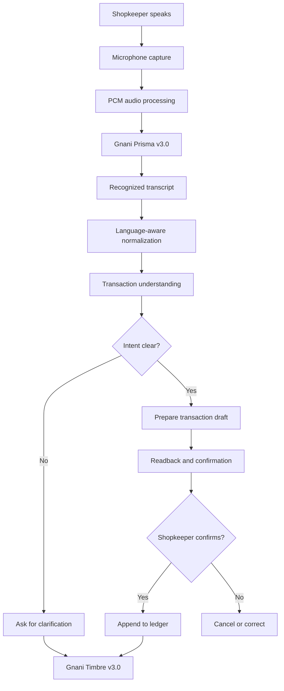
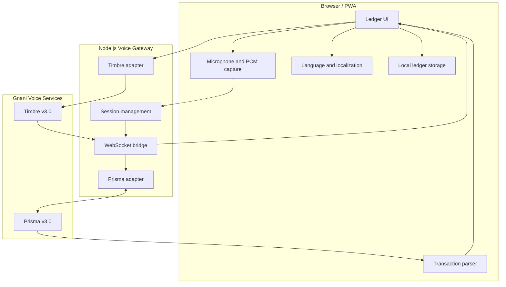
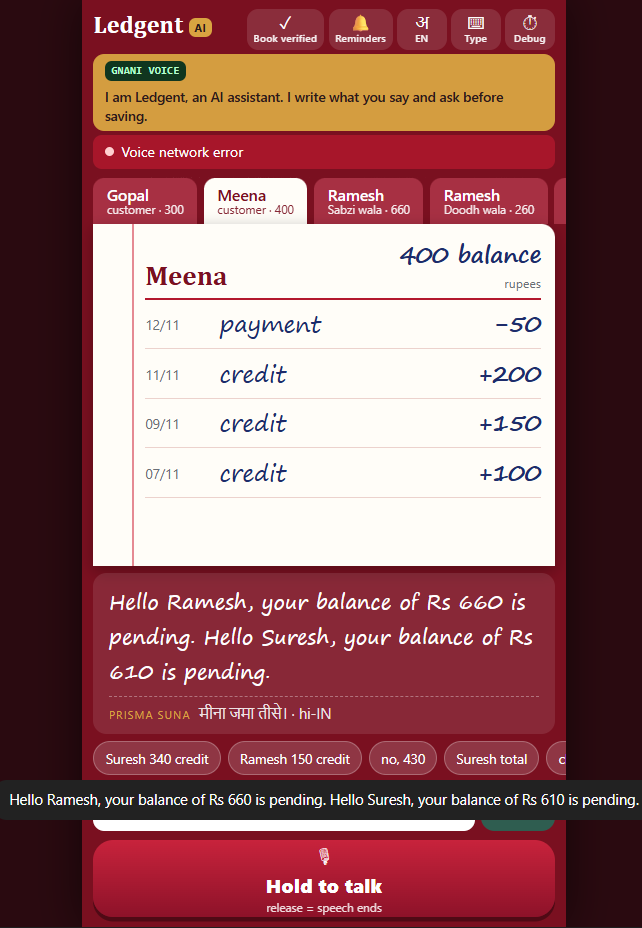
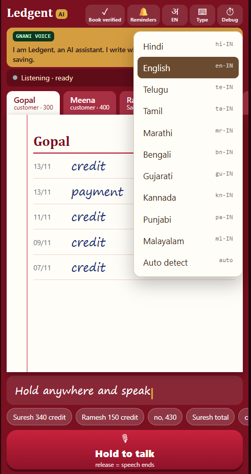
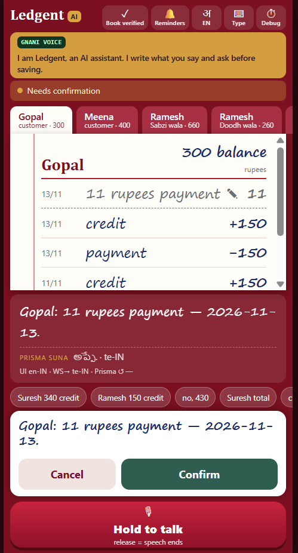

# Ledgent — The Voice-First Digital Khata

<p align="center">
  <strong>Your shop. Your language. Your ledger.</strong>
</p>

<p align="center">
  A multilingual, voice-first digital ledger designed for India's neighbourhood retailers.
  <br />
  Powered by Gnani Prisma v3.0 and Gnani Timbre v3.0.
</p>

<p align="center">
  
</p>

<p align="center">
  <strong>Built for the Gnani Voice Hackathon</strong>
</p>

---

## The Idea

Millions of small retailers across India still manage customer credit and daily payments using handwritten khata books.

These ledgers are familiar, simple and deeply integrated into everyday business. But maintaining them manually can become difficult when shops are busy, transactions are frequent, and customers expect quick answers.

What if a shopkeeper could simply speak to their ledger?

**Ledgent brings the traditional khata into the voice-first era.**

Instead of navigating complicated forms or typing every transaction, shopkeepers can speak naturally in their preferred language. Ledgent turns spoken interactions into structured ledger operations, asks for clarification when necessary, and saves transactions only after confirmation.

It is not another chatbot.

It is a voice-driven interface for everyday shop accounting.

## Why Ledgent?

Traditional accounting applications often expect users to adapt to the software.

Ledgent takes the opposite approach: the software adapts to the shopkeeper.

- Speak instead of typing.
- Interact in familiar Indian languages.
- Record customer credit and payments.
- Ask for outstanding balances.
- Correct mistakes through conversational interactions.
- Maintain individual customer ledgers.
- Confirm transactions before they are recorded.

The goal is simple: make digital bookkeeping feel as natural as maintaining a physical khata.

---

## Product Experience

### 1. A Digital Khata That Feels Familiar

The interface takes inspiration from the traditional Indian ledger notebook.

- Deep maroon ledger-inspired interface.
- Cream-coloured ruled notebook pages.
- Customer-specific ledger tabs.
- Handwritten-style transaction entries.
- Clear outstanding balance display.
- Mobile-first interaction designed for shop environments.

The experience preserves the familiarity of a physical khata while introducing the convenience of digital bookkeeping.

### 2. Voice-First Interaction

The primary interaction is a simple hold-to-talk experience.

1. Hold the microphone button.
2. Speak naturally.
3. Release to finish speaking.
4. Ledgent receives the recognized transcript.
5. The transaction engine extracts the relevant information.
6. Review and confirm before saving.

The interface also provides a text-entry fallback.

### 3. Multilingual by Design

Ledgent is designed around the linguistic diversity of Indian retailers.

| Language | Locale |
|---|---|
| Hindi | `hi-IN` |
| English | `en-IN` |
| Telugu | `te-IN` |
| Tamil | `ta-IN` |
| Kannada | `kn-IN` |
| Malayalam | `ml-IN` |
| Bengali | `bn-IN` |
| Marathi | `mr-IN` |

The application separates language recognition, transaction understanding and user-interface presentation.

This means the internal transaction model does not depend on Hindi words or a particular script.

For example, the internal transaction types remain:

- `CREDIT`
- `PAYMENT`
- `BALANCE_QUERY`
- `UNKNOWN`

The displayed labels, clarification prompts and spoken responses are localized according to the selected language.

**Language support status:** The eight-language integration has been exercised using synthesized audio, Prisma recognition round-trips and browser UI checks. Native-speaker microphone validation is still required to establish real-world recognition accuracy across all eight languages.

---

## Powered by Gnani AI Voice

Ledgent integrates two Gnani voice technologies.

### Gnani Prisma v3.0 — Speech Recognition

Prisma provides the speech-to-text layer.

Its role is to:

- Receive streaming microphone audio.
- Recognize spoken language.
- Return text transcripts.
- Supply language information to the application.
- Enable the transaction-understanding pipeline.

Ledgent uses WebSocket-based streaming rather than treating speech recognition as a simple text input.

### Gnani Timbre v3.0 — Speech Generation

Timbre powers the spoken response layer.

It is used for:

- Transaction readbacks.
- Clarification questions.
- Balance responses.
- Conversational confirmations.

The active application language is passed through the response pipeline so the spoken output can follow the selected locale.

### Voice Pipeline



---

## How Transaction Understanding Works

Speech recognition and transaction understanding are separate stages.

A transcript can be successfully recognized even when the application cannot confidently determine the transaction.

Ledgent preserves the original transcript instead of replacing it with a generic error.

The transaction engine works with structured information such as:

| Field | Purpose |
|---|---|
| Customer | Identifies the customer |
| Amount | Transaction value |
| Direction | Credit or payment |
| Date | Transaction date |
| Intent | Transaction, balance query or correction |
| Confidence | Helps determine whether clarification is needed |

### Ambiguity Handling

Consider a shop with two customers named Ramesh:

- Ramesh — Sabzi wala
- Ramesh — Doodh wala

If a spoken transaction only identifies Ramesh, Ledgent should ask which customer the shopkeeper means instead of silently selecting one.

This is an important part of making voice-driven accounting trustworthy.

### Confirmation Before Saving

Ledgent follows a confirmation-first transaction workflow.

A recognized sentence is not automatically a saved financial entry.

The shopkeeper reviews the transaction and explicitly confirms it before the ledger is updated.

---

## Architecture



### Technology Stack

| Layer | Technology |
|---|---|
| Frontend | HTML, CSS, JavaScript ES Modules |
| Application model | Mobile-first Progressive Web App |
| Backend gateway | Node.js |
| Real-time communication | WebSocket |
| Speech-to-text | Gnani Prisma v3.0 |
| Text-to-speech | Gnani Timbre v3.0 |
| Audio processing | Web Audio API, AudioWorklet |
| Local persistence | IndexedDB |
| Integrity | SHA-256 hash chaining |
| Testing | Node.js tests, Playwright |
| Runtime | Node.js 20+ |

The application deliberately avoids a heavy frontend framework and Docker dependency to keep the implementation lightweight.

---

## Data Integrity and Safety

Financial records require more care than ordinary chat messages.

Ledgent incorporates safeguards into its transaction workflow:

- Explicit confirmation before transaction creation.
- Customer disambiguation when names overlap.
- Integer-based monetary representation in paise.
- Append-only transaction history.
- Reversal-based correction design.
- Idempotency protection against duplicate writes.
- Serialized ledger appends.
- SHA-256 hash chaining for tamper-evident history.
- API credentials kept on the server side.
- No intentional audio or transcript persistence in the gateway.

**Integrity note:** Hash chaining makes unauthorized changes detectable under the intended verification model; it does not make a local ledger impossible to tamper with.

The hackathon demonstration should use synthetic or consented customer data.

---

## Project Structure

```text
ledgent/
│
├── gateway/
│   ├── server.js
│   ├── gnani.adapter.js
│   ├── env.js
│   ├── package.json
│   └── .env.example
│
├── js/
│   ├── app.js
│   ├── session.js
│   ├── answers.js
│   ├── lang.js
│   ├── i18n.js
│   ├── audio-capture.js
│   ├── pcm-worklet.js
│   └── voice-gnani.js
│
├── scripts/
│   ├── serve.mjs
│   ├── e2e.mjs
│   ├── verify-languages.mjs
│   └── verify-tts-languages.mjs
│
├── tests/
│
├── index.html
├── manifest.json
├── package.json
├── README.md
└── .gitignore
```

*The structure above highlights the main application areas; individual files may evolve as development continues.*

---

## Running Locally

### Prerequisites

- Node.js 20 or later.
- npm.
- A modern browser with microphone support.
- Gnani Prisma v3.0 and Timbre v3.0 API credentials.

### 1. Clone the repository

```bash
git clone https://github.com/YOUR_USERNAME/ledgent.git
cd ledgent
```

### 2. Install dependencies

```bash
npm install
```

### 3. Configure the voice gateway

Create the gateway environment file from the provided example:

```powershell
Copy-Item gateway/.env.example gateway/.env
```

Add your Gnani credentials and the required gateway configuration to `gateway/.env`, following the variable names in `.env.example`.

Never commit API keys or credentials.

### 4. Start the voice gateway

Open a terminal:

```bash
cd gateway
npm install
npm start
```

The gateway runs on:

```text
http://localhost:8787
```

Health endpoint:

```text
http://localhost:8787/health
```

### 5. Start the application

Open a second terminal from the project root:

```bash
npm start
```

Open:

```text
http://localhost:8080
```

Allow microphone access when prompted.

**Important:** Keep both the frontend and gateway terminals running during local voice testing. Use the exact origin and port configured in the gateway allowlist.

---

## Testing

Run the automated tests:

```bash
npm test
```

Run the end-to-end checks:

```bash
npm run e2e
```

Run the combined checks:

```bash
npm run check
```

Run language phrase tests:

```bash
npm run phrases
```

Run the language verification script:

```bash
node scripts/verify-languages.mjs
```

Run the TTS language verification:

```bash
node scripts/verify-tts-languages.mjs
```

These scripts help validate the recognition, parsing, localization and speech-generation integration.

Automated and synthesized-audio tests should not be confused with native-speaker testing on a physical microphone.

---

## Privacy and Security Principles

Ledgent is designed around a few important principles:

1. Keep voice credentials out of frontend code.
2. Do not expose API keys in public repositories.
3. Avoid unnecessary audio and transcript retention.
4. Use synthetic or consented data during demonstrations.
5. Ask for confirmation before changing financial records.
6. Avoid silently guessing when recognition or transaction intent is uncertain.

Never upload `.env` files, customer information or private voice recordings to the public repository.

---

## Screenshots

The interface is inspired by the familiar physical khata notebook.

Add your screenshots in `assets/screenshots/` and update the image paths below.

### Main Ledger



### Voice Interaction


### Multilingual Experience



### Transaction Confirmation



### Customer Ledger


---


## Roadmap

- [x] Ledger-inspired mobile interface.
- [x] Customer-specific ledger views.
- [x] Voice gateway integration.
- [x] Gnani Prisma v3.0 integration.
- [x] Gnani Timbre v3.0 integration.
- [x] Transaction confirmation workflow.
- [x] Duplicate-customer clarification.
- [x] Eight-language UI and locale integration.
- [x] Localized presentation and readback pipeline.
- [ ] Real-world native-speaker validation across all eight languages.
- [ ] Physical Android device testing across different network conditions.
- [ ] Deployment and hosted demonstration.
- [ ] Expanded accessibility and usability testing.

---

## Built For

**Gnani Voice Hackathon**

Ledgent explores how real-time speech technology can make everyday financial record-keeping more accessible to India's small retailers.

The ambition is not to make shopkeepers learn another complicated application.

It is to make technology understand the way they already communicate.

<p align="center">
  <strong>Ledgent</strong>
  <br />
  Your shop. Your language. Your ledger.
</p>

---

## Acknowledgements

- Gnani AI — Prisma v3.0 and Timbre v3.0 voice technologies.
- The small retailers and neighbourhood businesses whose everyday workflows inspire this project.

---

## License

Add your chosen open-source license here before publishing. Until a license is added, all rights remain with the repository owner.
