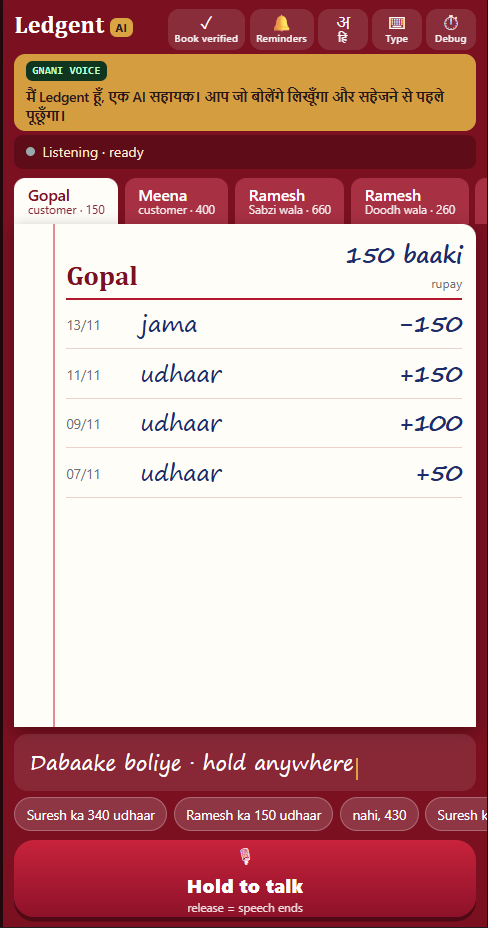
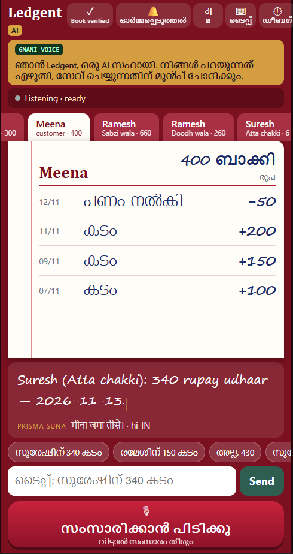
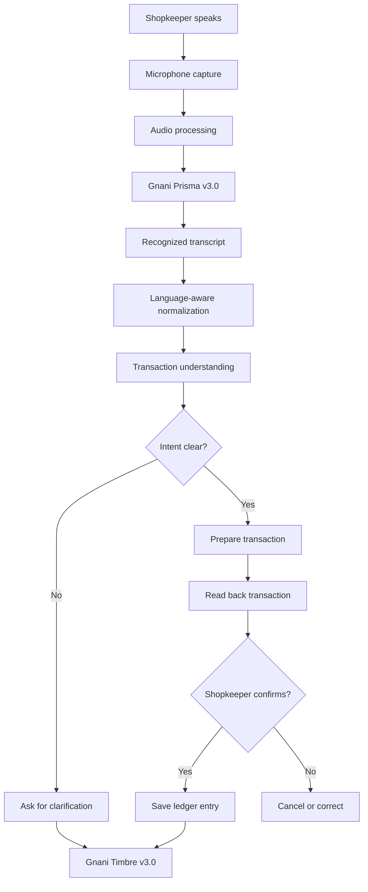
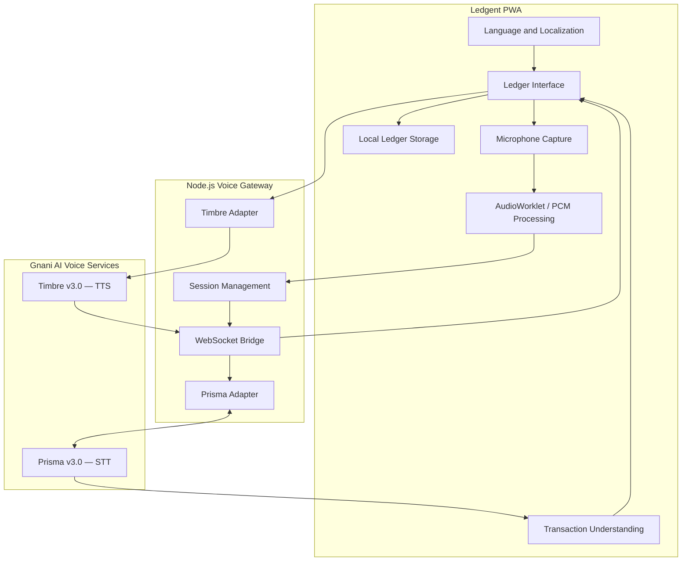

# Ledgent — Your Shop. Your Language. Your Ledger.

<p align="center">
  
</p>

<p align="center">
  <strong>A multilingual, voice-first digital khata built for India's neighbourhood retailers.</strong>
  <br />
  Speak naturally. Record transactions. Manage customer credit. In your language.
</p>

<p align="center">
  <strong>Powered by Gnani Prisma v3.0 and Gnani Timbre v3.0</strong>
</p>

---

## The Problem

Across India, neighbourhood retailers manage customer credit and daily payments using traditional handwritten khata books.

These books are familiar and accessible, but maintaining them manually becomes difficult when:

- Multiple customers make transactions throughout the day.
- Shopkeepers have limited time to type or navigate applications.
- Customers ask for outstanding balances.
- Similar customer names can cause accounting mistakes.
- Digital accounting applications introduce language and usability barriers.

For many shopkeepers, the problem is not a lack of technology. It is that technology expects them to change the way they already work.

**We asked a different question: What if the technology understood the shopkeeper instead?**

## Our Solution — Ledgent

Ledgent transforms the familiar Indian khata into a voice-first digital experience.

A shopkeeper can speak naturally in a supported language, and Ledgent processes the speech, understands the intended transaction, prepares a structured entry, and asks for confirmation before saving it.

It brings together:

- A familiar, ledger-inspired interface.
- Real-time speech recognition through Gnani Prisma.
- Spoken responses through Gnani Timbre.
- Multilingual interface and language handling.
- Customer-specific credit and payment records.
- Transaction clarification and confirmation.
- A lightweight, mobile-first Progressive Web App.

**Ledgent is not another chatbot. It is a voice-driven interface for everyday shop accounting.**

---

## See Ledgent in Action

### 1. The Digital Khata

<p align="center">
  
</p>

A familiar ledger-inspired interface with customer records, outstanding balances, and transaction history.

### 2. Voice-First Interaction

<p align="center">
  
</p>

Speak naturally instead of typing every transaction. The application captures speech and displays the recognized transcript for transaction understanding.

### 3. Multilingual Experience

<p align="center">
  
</p>

The interface follows the selected language, with explicit language selection and locale handling across the voice pipeline.

### 4. Transaction Confirmation

<p align="center">
  
</p>

A recognized sentence is not automatically treated as a completed financial transaction. Ledgent prepares a transaction for review and confirmation before saving.

---

## What Makes Ledgent Different?

| Typical digital bookkeeping | Ledgent |
|---|---|
| Primarily form and keyboard driven | Voice-first interaction |
| Often assumes a preferred interface language | Designed for multiple Indian languages |
| Requires users to navigate accounting workflows | Uses natural conversational input |
| Can make incorrect assumptions about ambiguous input | Preserves transcripts and asks for clarification |
| Treats speech as an additional input method | Builds the transaction workflow around voice |

Our central design principle is simple:

**The shopkeeper should not have to learn how to speak to software. The software should adapt to how the shopkeeper communicates.**

---

## Multilingual by Design

India's retail ecosystem is linguistically diverse. Ledgent is designed with that reality at its core.

The application currently integrates eight language locales:

| Language | Locale |
|---|---|
| Hindi | `hi-IN` |
| English | `en-IN` |
| Telugu | `te-IN` |
| Tamil | `ta-IN` |
| Kannada | `kn-IN` |
| Malayalam | `ml-IN` |
| Bengali | `bn-IN` |
| Marathi | `mr-IN` |

Language selection is explicit. The selected locale is carried through the application and voice gateway instead of relying on an implicit default.

The application separates:

1. Selected language and locale.
2. Speech recognition.
3. Transaction understanding.
4. Interface localization.
5. Spoken response generation.

This separation matters. A recognized transcript can be correct even when transaction intent is unclear. Ledgent preserves the original transcript and can request clarification instead of silently replacing what the shopkeeper said.

**Validation status:** The multilingual integration has been exercised with synthesized audio, Prisma recognition round-trips, browser microphone-pipeline tests, and localized interface checks. Native-speaker validation across all eight languages remains future work.

---

## Powered by Gnani AI Voice

Gnani's voice technologies are not decorative additions to Ledgent. They form the core of the interaction model.

### Gnani Prisma v3.0 — Speech to Text

Prisma powers the speech recognition layer.

It enables Ledgent to:

- Capture microphone audio.
- Stream audio through a WebSocket connection.
- Receive recognized text.
- Work with the requested language locale.
- Pass transcripts to the transaction-understanding layer.

### Gnani Timbre v3.0 — Text to Speech

Timbre powers the spoken response experience.

It is used for:

- Transaction readbacks.
- Clarification questions.
- Balance responses.
- Conversational confirmations.

The active language is passed through the response pipeline so spoken feedback can follow the shopkeeper's selected locale.

### End-to-End Voice Workflow



---

## How a Transaction Works

Consider a shopkeeper recording a customer's purchase on credit.

The workflow is designed to be understandable and safe:

1. The shopkeeper speaks into the microphone.
2. Prisma recognizes the spoken input.
3. Ledgent preserves and displays the transcript.
4. The transaction engine identifies the customer, amount, and transaction intent.
5. If important information is ambiguous, Ledgent asks a clarification question.
6. Ledgent reads back the proposed transaction.
7. The shopkeeper confirms or corrects it.
8. The ledger is updated only after confirmation.

### Structured Transaction Understanding

| Field | Purpose |
|---|---|
| Customer | Identifies the customer |
| Amount | Represents the transaction value |
| Direction | Credit or payment |
| Date | Transaction date |
| Intent | Transaction, balance query, correction, or unknown |
| Confidence | Helps determine when clarification is necessary |

### Handling Ambiguous Customers

Imagine two customers named Ramesh:

- Ramesh — Sabzi wala
- Ramesh — Doodh wala

If the shopkeeper says only "Ramesh", the application should not silently choose a customer.

It should ask which Ramesh is intended.

This is important because an accounting application must prioritize correctness over guessing.

### Confirmation Before Saving

A transcript is not a transaction.

A proposed transaction is not a saved transaction.

Ledgent separates recognition, interpretation, and confirmation so that an uncertain voice input does not automatically become a financial record.

---

## Technical Architecture

Ledgent uses a lightweight frontend and a dedicated Node.js gateway to connect the browser with Gnani's voice services.



### Technology Stack

| Component | Technology |
|---|---|
| Frontend | HTML, CSS, JavaScript ES Modules |
| Application | Progressive Web App |
| Backend | Node.js |
| Real-time communication | WebSocket |
| Speech recognition | Gnani Prisma v3.0 |
| Speech generation | Gnani Timbre v3.0 |
| Audio processing | Web Audio API, AudioWorklet |
| Persistence | IndexedDB |
| Integrity mechanisms | SHA-256 hash chaining |
| Testing | Node.js tests, Playwright |

The implementation avoids a heavy frontend framework and keeps the voice gateway separate from the browser application.

---

## Engineering Beyond the Demo

We wanted Ledgent to be more than a visually convincing prototype.

Several engineering decisions were made around real-world bookkeeping requirements.

### 1. Language Consistency Across the Pipeline

The selected locale is explicitly carried through the UI and gateway. The application exposes language trace information to help verify which locale was requested and used.

### 2. Transcript Preservation

Speech recognition and transaction interpretation are separate operations. If the transaction parser cannot understand a recognized sentence, Ledgent preserves the transcript instead of discarding it.

### 3. Customer Disambiguation

Similar customer names should trigger clarification rather than an arbitrary selection.

### 4. Confirmation-First Accounting

Transactions require explicit confirmation before they are recorded.

### 5. Server-Side Voice Credentials

Gnani API credentials are configured in the Node.js gateway rather than embedded in frontend JavaScript.

### 6. Data Integrity

The project incorporates integrity-oriented mechanisms such as integer-based monetary representation in paise, append-oriented transaction handling, duplicate-write protection, and SHA-256 hash chaining.

Hash chaining helps make unauthorized modifications detectable under the intended verification model; it does not make a local ledger impossible to tamper with.

---

## Testing and Validation

Ledgent includes automated checks for the application, transaction understanding, and voice integration.

Validation work includes:

- Transaction parsing and language-specific phrase tests.
- Multilingual UI checks.
- Locale propagation through the frontend and gateway.
- WebSocket voice-gateway integration.
- Prisma recognition round-trip tests.
- Timbre response-language checks.
- Browser microphone capture pipeline tests.
- End-to-end application checks.

The eight-language voice integration has been exercised using synthesized audio and automated test flows.

**Important distinction:** Automated synthesized-audio validation does not establish real-world recognition accuracy for every language, accent, speaker, or noisy shop environment. Native-speaker and physical-device validation are still required.

---

## Running Ledgent Locally

### Prerequisites

- Node.js 20 or later.
- npm.
- A modern browser with microphone support.
- Gnani Prisma v3.0 and Timbre v3.0 credentials.

### 1. Clone the repository

```bash
git clone https://github.com/MudadlaPranay12/Ledgent.git
cd Ledgent
```

### 2. Install frontend dependencies

```bash
npm install
```

### 3. Configure the voice gateway

Create the gateway environment file:

```powershell
Copy-Item gateway/.env.example gateway/.env
```

Add the required Gnani credentials and gateway configuration to `gateway/.env`, following the variable names in `.env.example`.

Never commit API keys or credentials.

### 4. Install gateway dependencies

```powershell
cd gateway
npm install
```

### 5. Start the voice gateway

```powershell
npm start
```

The gateway runs at:

```text
http://localhost:8787
```

Health endpoint:

```text
http://localhost:8787/health
```

### 6. Start the frontend

Open another terminal at the project root:

```powershell
npm start
```

Open:

```text
http://localhost:8080
```

Allow microphone access when prompted.

Keep both the frontend and gateway running while testing voice interactions. The browser origin must be allowed by the gateway configuration.

---

## Project Roadmap

| Feature | Status |
|---|---|
| Ledger-inspired interface | Complete |
| Customer-specific ledger views | Complete |
| Node.js voice gateway | Integrated |
| Gnani Prisma v3.0 | Integrated |
| Gnani Timbre v3.0 | Integrated |
| Voice-driven transaction workflow | Implemented |
| Transaction confirmation | Implemented |
| Ambiguous customer clarification | Implemented |
| Eight-language locale integration | Implemented |
| Localized interface and spoken responses | Implemented |
| Native-speaker validation across all languages | Planned |
| Physical Android device testing | Planned |
| Deployment and hosted demonstration | Planned |
| Expanded usability testing with retailers | Planned |

---

## Why We Built It

We believe access to technology should not depend on how comfortable someone is with typing, navigating complex applications, or using a particular language.

For neighbourhood retailers, the khata is more than a notebook. It is part of their daily business workflow and their relationship with customers.

Ledgent explores how real-time speech technology can make that workflow more accessible without abandoning what already works.

Our goal is not to replace the shopkeeper's way of working.

**Our goal is to make technology understand it.**

---

## Built For

**Gnani Voice Hackathon**

### Team Project: Ledgent

**Your shop. Your language. Your ledger.**

### Acknowledgements

- Gnani AI — Prisma v3.0 and Timbre v3.0 voice technologies.
- India's neighbourhood retailers, whose everyday workflows inspired this project.

---

## License

No open-source license has been added yet. All rights remain with the repository owner unless a license is explicitly added.
